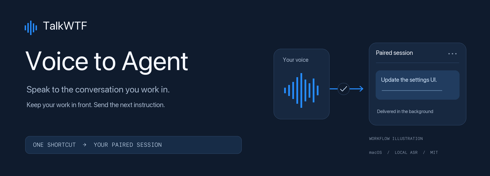
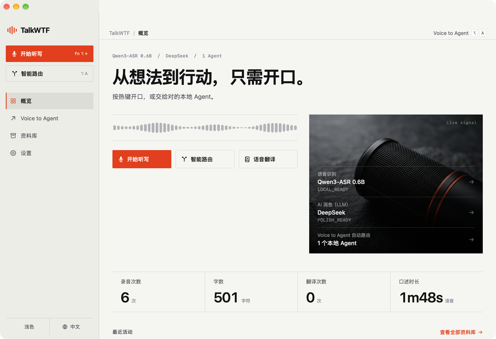
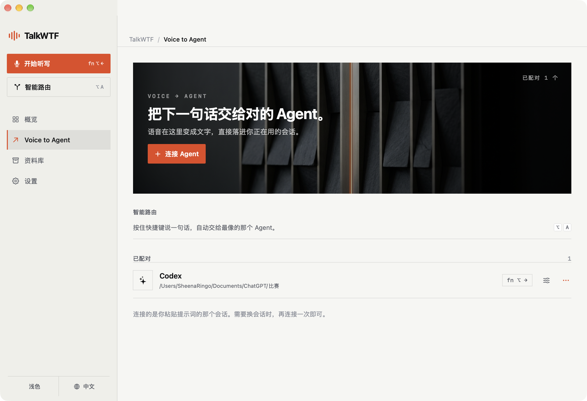

<p align="center">
  <a href="README.md"><strong>English</strong></a> · <a href="README.zh-CN.md">简体中文</a>
</p>

<p align="center">
  
</p>

<p align="center">
  <strong>A voice interface for the Agent conversations you work in.</strong><br />
  Pair a conversation. Set a shortcut. Speak your next instruction.
</p>

<p align="center">
  
  
  <a href="LICENSE"></a>
  
</p>

<p align="center">
  <a href="#voice-to-agent">Voice to Agent</a> · <a href="#get-started">Get started</a> · <a href="#connection-support">Connection support</a> · <a href="BUILD.md">Build guide</a>
</p>

<p align="center">
  
  
</p>

<p align="center">
  <sub>The app as it ships now: flat editorial shell, smart routing, and a library that keeps failed recordings.</sub>
</p>

---

Keep your editor, browser, or canvas in front while you speak an instruction to a paired Agent conversation. **TalkWTF turns voice into a way to work with your agents**, with local speech recognition, a shortcut for each destination, and background delivery.

**Voice to Agent is the product’s focus.** AI-assisted dictation, translation, and a personal dictionary also make TalkWTF useful throughout your day on the Mac.

## Voice to Agent

You have a change in mind. Instead of finding the right chat, clicking its input field, and typing it out, use the shortcut you assigned to that conversation.

| Connect | Pair | Speak |
| :--- | :--- | :--- |
| Choose the local Agent you use. | Copy the connection prompt into the conversation you want to reach. | Set its shortcut, then speak your instructions from another app. |
| TalkWTF prepares the connection instructions. | The Agent sets up its receiving connection; TalkWTF confirms the saved pairing. | TalkWTF transcribes locally and sends the text to that paired destination. |

The default setup asks you to **choose, copy, and paste**. The receiving Agent handles session identifiers and connection details using the capabilities its host provides.

### Stay with the task in front of you

- **A shortcut for each conversation.** Keep separate destinations for a code change, a writing project, or another supported workflow.
- **A fixed destination while recording.** TalkWTF captures the target when you start speaking, so switching windows does not change where an Agent instruction goes.
- **Background delivery.** The Agent workflow sends text through its connection, without pasting into the foreground app or switching focus.
- **Recoverable failures.** If delivery fails or its outcome is unknown, keep the transcript, inspect the destination, and decide what to do next. TalkWTF does not resend automatically.

## Get started

**Requirements:** an Apple Silicon Mac, macOS 14 or later, Xcode, and Rust stable. For Voice to Agent, use a local Agent that can read files, run commands, and receive messages in the chosen conversation.

### Build and open TalkWTF

Follow the [build guide](BUILD.md) for toolchain setup, building, and packaging. A typical source build is:

```sh
git clone https://github.com/lonzhijun/TalkWTF.git
cd TalkWTF
xcodebuild -project macos/TalkWTF.xcodeproj -target TalkWTF -configuration Debug build
```

Open `macos/build/Debug/TalkWTF.app`. Grant microphone access and the permissions needed for your workflow, then download a local speech model in Settings. Configure your own provider and API key if you want cloud polishing or translation.

### Connect a conversation

1. Open **Voice to Agent → Connect Agent**.
2. Select your Agent and copy the generated prompt.
3. Paste it into the conversation you want to connect. Let the Agent follow the local setup instructions.
4. Return to TalkWTF. After it confirms the pairing, assign a shortcut.

Connection prompts expire after ten minutes. If one expires, generate a new prompt. Closing the setup cancels an unfinished request.

**Release stage:** experimental, source-first software. The app uses ad-hoc signing and is not Apple-notarized. Start with the build guide; this is not yet a broadly validated consumer release.

## Connection support

The connection picker includes **Codex, Claude Code, OpenCode, Cursor, and other local agents**. A picker entry identifies the client you are using; successful delivery also requires that client to expose a usable route into the selected conversation.

| Route | Current implementation |
| :--- | :--- |
| **Codex session continuation** | Register an explicit existing session ID and continue it through the local Codex CLI. Desktop live refresh and behavior during an already-running turn depend on the host. |
| **Local receiving adapter** | The Agent can register a loopback HTTP receiver or a conversation-specific command adapter using its host’s supported interfaces. |
| **Browser-only chats** | Local pairing is not currently supported. |

Pairing, receipts, session binding, and local adapter delivery have been tested. **Full microphone-to-client testing across the listed Agent applications is still in progress.** An accepted pairing confirms saved connection information; it does not prove that an Agent has completed a task.

For the connection protocol and implementation scope, see [the pairing specification](docs/specs/phase-21-agent-pairing.md).

## More ways to use your voice

| Capability | What you can do |
| :--- | :--- |
| **Local speech recognition** | Transcribe on your Mac with the local ASR engine. |
| **AI polishing** | Choose a writing style and scenario; use your own key to connect directly to a supported provider. Polishing failure falls back to the transcript. |
| **Voice translation** | Use a separate translation shortcut and manage up to three target languages. |
| **Personal vocabulary** | Maintain words and correction rules, import or export them, and undo learned corrections. |
| **Smart routing** | Speak once and let TalkWTF pick the closest Agent. It dispatches only when the match is clear, and asks instead of guessing. |
| **Recording black box** | A failed transcription keeps its audio. Re-transcribe it from the library, export it, or delete it. |
| **History** | Search, copy, and manage transcripts and recording retention. |
| **Native macOS controls** | Use the menu bar, floating recording panel, light/dark appearance, and hold, toggle, or combined shortcut behavior. |

The app bundles 26 locale packs. Some newer interface text, including parts of the Agent setup, is currently in Simplified Chinese.

## Your data, your connections

Speech recognition runs on your Mac. Model downloads use the network. If you enable cloud polishing or translation, TalkWTF sends the text and the required vocabulary or scenario context directly to the provider you configure.

Voice to Agent sends transcript text to the paired receiving route. The Agent may then use its own model provider and tools under that client’s settings. **Local recognition does not make the entire Agent workflow offline.**

TalkWTF has no self-hosted cloud relay, TalkWTF account system, subscription service, or telemetry. History and recording retention are local settings. Automatic vocabulary learning uses Accessibility access to observe edits after dictation. The project has not undergone an independent security audit.

<details>
<summary><strong>For contributors: implementation and checks</strong></summary>

### Project layout

```text
macos/TalkWTF/        SwiftUI app, shortcuts, recording panel, pairing and delivery
core/core/           Rust speech, settings, dictionary and processing engine
core/ffi/            C bridge between Swift and Rust
resources/           Model metadata, local resources and locale packs
tests/agent-delivery/ Pairing and delivery integration checks
docs/specs/          Product decisions, scope and implementation records
```

The app uses a native SwiftUI shell and a Rust core. The `connect-agent` command runs through the bundled app executable and exits after writing a local receipt. A one-time request binds the response to its target, client choice, and token.

### Checks

```sh
cargo test --manifest-path core/core/Cargo.toml
cargo test --manifest-path core/ffi/Cargo.toml
python3 tests/agent-delivery/run.py
```

The delivery checks use local fixtures rather than real Agent tasks. They cover literal transcript delivery, session continuation, failed responses, redirects, pairing expiry, cancellation, token/client matching, and delivery through a registered adapter. See [BUILD.md](BUILD.md) for the full validation workflow.

Development uses AI assistance, with product choices, implementation stages, and validation boundaries recorded in the specifications.

</details>

## Built on open source

TalkWTF builds on [Handy](https://github.com/cjpais/Handy), with parts of the polishing and dictionary logic and UX adapted from [OpenTypeless](https://github.com/tover0314-w/opentypeless). TalkWTF adds its own product direction, native interface, and Voice to Agent connection workflow.

[MIT license](LICENSE) · [Third-party notices](THIRD_PARTY_NOTICES.md). Dependencies and downloaded models retain their respective licenses. TalkWTF is an independent project, unaffiliated with the Agent clients listed above.

---

## Web UI（实验内容，仅作设计参考）

`web/` 是 2026-11 用 AI Studio 重做的网页版界面，**不是** macOS 原生 app 的构建入口，
也不参与 `scripts/package.sh` 的原生打包。它只用于对照设计、后续移植 UI。

- 网页版说明与运行方式：`web/README.md`
- 原生 app（SwiftUI + Rust）仍在 `macos/`、`core/`，构建方式见 `BUILD.md`
