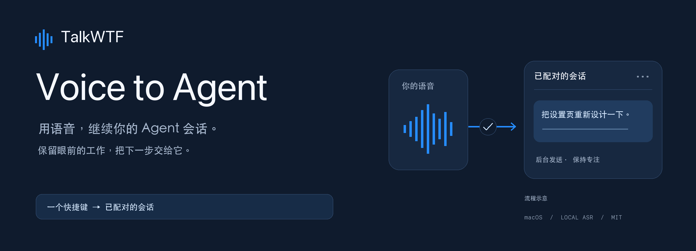
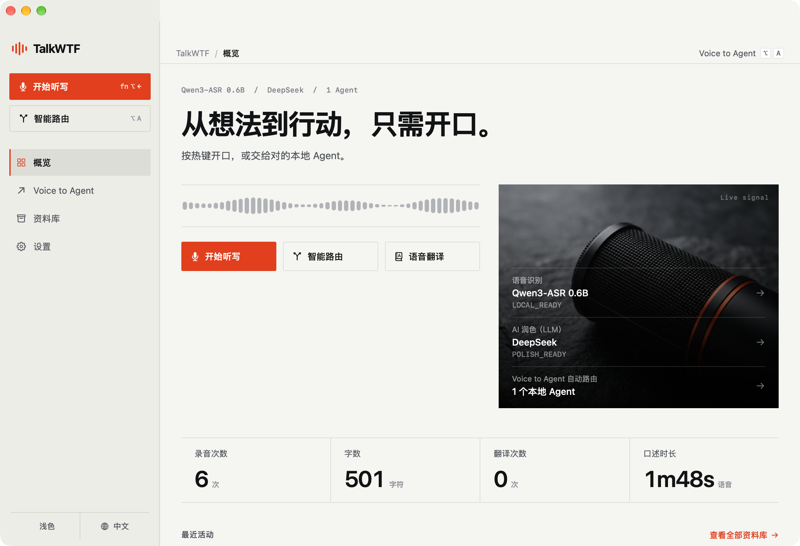
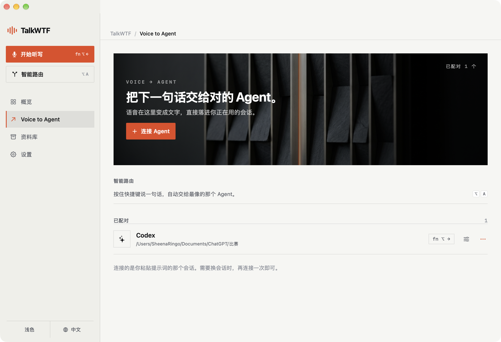

<p align="center">
  <a href="README.md">English</a> · <a href="README.zh-CN.md"><strong>简体中文</strong></a>
</p>

<p align="center">
  
</p>

<p align="center">
  <strong>用语音，继续你正在进行的 Agent 会话。</strong><br />
  连接会话，设置快捷键，说出下一步。
</p>

<p align="center">
  
  
  <a href="LICENSE"></a>
  
</p>

<p align="center">
  <a href="#voice-to-agent">Voice to Agent</a> · <a href="#开始使用">开始使用</a> · <a href="#连接支持">连接支持</a> · <a href="BUILD.md">构建指南</a>
</p>

<p align="center">
  
  
</p>

<p align="center">
  <sub>现在发布的样子：扁平编辑器风格、智能路由，以及会保留失败录音的资料库。</sub>
</p>

---

你可以继续看着编辑器、浏览器或画布，直接说出要交给 Agent 的下一条指令。**TalkWTF 让你用语音与 Agent 协作**：在 Mac 上识别语音，为不同会话设置快捷键，并在后台把文字送到已配对的目标。

**Voice to Agent 是这个产品的主线。** AI 润色听写、翻译和个人词典，也让你能在日常工作中持续使用它。

## Voice to Agent

想到一个修改，按下对应会话的快捷键，直接说出来。你不必先寻找聊天窗口、点进输入框，再把思路重新打成文字。

| 选择 Agent | 完成配对 | 开口交代 |
| :--- | :--- | :--- |
| 选择你正在用的本地 Agent。 | 把连接提示词复制到你希望接收语音的会话。 | 设置快捷键，在其他应用中说出任务。 |
| TalkWTF 准备本机连接说明。 | Agent 根据自身能力建立接收连接，TalkWTF 确认保存的配对。 | TalkWTF 在本机转写，再把文字送到这个目标。 |

默认引导只需要你**选择、复制、粘贴**。会话编号和接入细节由接收方 Agent 根据其客户端提供的能力处理。

### 让手头的工作继续

- **一个会话，一个快捷键。** 给代码修改、写作项目或其他支持的工作流分别设置接收目标。
- **录音开始时确定目标。** 中途切换窗口，不会改变这条 Agent 指令的发送对象。
- **后台发送。** Agent 工作流通过连接投递文字，不向前台应用粘贴，也不切换焦点。
- **失败后保留内容。** 发送失败或结果不明时，保留转写内容供你检查和处理，不自动重复发送。

## 开始使用

**环境要求：** Apple Silicon Mac、macOS 14 及以上、Xcode 和 Rust stable。使用 Voice to Agent 时，接收方需要是能读取本机文件、执行命令，并能向指定会话接收消息的本地 Agent。

### 构建并打开 TalkWTF

工具链准备、构建和打包步骤见 [构建指南](BUILD.md)。常见的源码构建方式：

```sh
git clone https://github.com/lonzhijun/TalkWTF.git
cd TalkWTF
xcodebuild -project macos/TalkWTF.xcodeproj -target TalkWTF -configuration Debug build
```

打开 `macos/build/Debug/TalkWTF.app`，按所用工作流授予麦克风等权限，在设置中下载本地语音模型。需要云端润色或翻译时，再配置自己的服务商与 API key。

### 连接一个会话

1. 打开 **Voice to Agent → 连接 Agent**。
2. 选择 Agent，复制生成的提示词。
3. 粘贴到你想连接的会话，让 Agent 按本机说明完成设置。
4. 回到 TalkWTF，看到配对确认后，设置快捷键。

连接提示词十分钟后失效，过期后重新生成即可。关闭引导会取消尚未完成的请求。

**发布阶段：** 当前为实验阶段，主要以源码形式提供。应用使用 ad-hoc 签名，尚未进行 Apple 公证；建议先按构建指南使用，目前还不是经过广泛验证的大众稳定版。

## 连接支持

连接选择器提供 **Codex、Claude Code、OpenCode、Cursor 和其他本地 Agent**。选项用于标识你使用的客户端；能否送达，还取决于该客户端是否提供可用的指定会话接收方式。

| 接入方式 | 当前实现 |
| :--- | :--- |
| **Codex 会话续接** | 登记明确的既有会话编号，通过本地 Codex CLI 续接。桌面界面实时刷新，以及会话正在运行时的行为，取决于具体客户端。 |
| **本地接收适配器** | Agent 可使用自身支持的接口，登记本机 HTTP 接收入口或会话专属命令。 |
| **仅网页聊天** | 当前不支持本地配对。 |

已验证配对、回执、会话绑定和本地适配器投递。**真实麦克风到上述各家 Agent 客户端的完整联调仍在进行。** 配对成功表示连接信息已保存，不代表 Agent 已完成任务。

接入协议与实现范围见 [配对说明](docs/specs/phase-21-agent-pairing.md)。

## 日常语音能力

| 能力 | 你可以做什么 |
| :--- | :--- |
| **本地语音识别** | 通过本地 ASR 引擎，在自己的 Mac 上转写。 |
| **AI 润色** | 选择写作风格和使用场景，用自己的 key 直连支持的服务商；润色失败时回退到转写文本。 |
| **语音翻译** | 使用独立翻译快捷键，管理最多三种目标语言。 |
| **个人词汇** | 维护词汇和纠正规则，导入导出，并撤销自动学到的纠错。 |
| **智能路由** | 说一句，让 TalkWTF 挑最像的那个 Agent。有把握才投递，没把握就停下来问，不瞎猜。 |
| **录音黑匣子** | 转写失败的录音不会丢。在资料库的「待恢复」里重新转录、导出或删除。 |
| **历史记录** | 搜索、复制和管理转写内容，设置录音留存方式。 |
| **原生 macOS 交互** | 使用菜单栏、录音悬浮窗、浅深主题，以及按住、切换或组合式快捷键行为。 |

应用附带 26 套语言包。部分新增界面文字，包括 Agent 设置中的部分内容，目前以简体中文为主。

## 数据与连接

语音识别在本机执行，下载模型需要联网。启用云端润色或翻译后，TalkWTF 会把文本及所需的词典、场景信息直接发送给你配置的服务商。

Voice to Agent 会把转写文本发送到已配对的接收入口。之后，Agent 按其客户端设置调用自己的模型服务和工具。**本地识别不等于整条 Agent 工作流完全离线。**

TalkWTF 没有自建云中转、TalkWTF 账号体系、订阅服务或遥测。历史与录音留存由本地设置控制；自动学词通过辅助功能权限观察听写后的输入修改。项目尚未经过独立安全审计。

<details>
<summary><strong>开发者：实现与检查</strong></summary>

### 目录结构

```text
macos/TalkWTF/        SwiftUI 界面、快捷键、录音悬浮窗、配对与投递
core/core/           Rust 语音、设置、词典与处理引擎
core/ffi/            Swift 与 Rust 之间的 C 桥接
resources/           模型元数据、本地资源与语言包
tests/agent-delivery/ 配对与投递集成检查
docs/specs/          产品取舍、范围和阶段实现记录
```

应用使用原生 SwiftUI 外壳和 Rust 核心。内置 `connect-agent` 命令通过应用自身的可执行文件运行，写入本机回执后退出。一次性请求会核对目标、客户端选择与令牌。

### 检查

```sh
cargo test --manifest-path core/core/Cargo.toml
cargo test --manifest-path core/ffi/Cargo.toml
python3 tests/agent-delivery/run.py
```

投递检查使用本机测试接收端，不执行真实 Agent 任务。覆盖转写原样传递、会话续接、失败响应、重定向、配对过期、取消、令牌与客户端匹配，以及已登记适配器的实际接收。完整验证流程见 [BUILD.md](BUILD.md)。

开发使用 AI 辅助，产品取舍、实现阶段与验收边界保留在阶段说明中。

</details>

## 开源基础

TalkWTF 基于 [Handy](https://github.com/cjpais/Handy)，部分润色、词典逻辑与交互参考并移植自 [OpenTypeless](https://github.com/tover0314-w/opentypeless)。项目在此基础上发展自己的产品方向、原生界面与 Voice to Agent 连接流程。

[MIT 协议](LICENSE) · [第三方许可说明](THIRD_PARTY_NOTICES.md)。依赖和下载模型遵循各自许可。TalkWTF 为独立项目，与上述 Agent 客户端无隶属关系。
